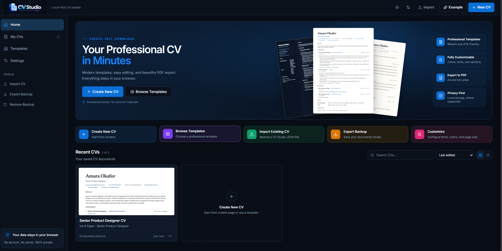

# CV Studio

<p align="center">
  <a href="https://naveenkrishnanpersonal.github.io/Free-CV-Creator/">
    
  </a>
</p>

<p align="center">
  <a href="https://naveenkrishnanpersonal.github.io/Free-CV-Creator/">
    
  </a>
  
  
  
  
  
  
  
  
  
</p>

A local-first CV/resume builder with a real renderer, complete content editing, and a live A4/Letter preview.

**Privacy:** documents are stored in this browser (IndexedDB). There is no server, account, analytics or upload.

## Run it

```bash
npm install
npm run dev
```

Then open the printed local URL. Node 22.12+ is required.

```bash
npm run typecheck   # TypeScript 7, strict
npm test            # Vitest unit + component tests
npm run build       # typecheck + production bundle
npm run e2e         # Playwright browser suite (starts its own dev server)
```

The end-to-end suite uses the installed Google Chrome (`channel: 'chrome'`). It exercises the dashboard (search, views, rename, backup restore, template and settings dialogs, no-scroll desktop fit, mobile drawer), creates and edits a CV, verifies the live preview and paper switch, waits for autosave, reloads, checks the library, exports JSON, opens dialogs, opens the example, toggles section visibility, checks the mobile preview, uploads a photo and adjusts its crop, browses and applies all 20 styles, edits text, bullets and sections directly on the page, reorders sections by rail drag-and-drop and on-page controls, edits design tokens and custom CSS in the Style Lab, and renders a real PDF with `page.pdf()` to assert A4/Letter page dimensions and a clean print layer (no editor chrome).

## What works today

- Dashboard: a single-view desktop studio with a hero preview, five quick actions, template and settings dialogs, live saved-CV thumbnails, search, name/date sorting, grid and list views, rename, duplicate, export to PDF, delete, and full backup export/restore. The shell keeps the page fixed at desktop sizes; only the dashboard content area scrolls when a list grows beyond the viewport.
- Editor: header/contact/photo/profiles, summary, 13 section types, entries with dates, bullets, tags, layouts, free section reordering (drag any section anywhere in the rail, or nudge it up/down on the page), show/hide, add/remove/duplicate.
- Direct page editing: click any line on the A4 page to type, hover a line for × to remove it, add highlights/tags/entries inline, add a section after any section (or at the end), move a section with the ↑/↓ controls on its heading, and open the matching form when you want it. Photo visibility is switchable from the preview toolbar. Section tools, line controls and the "Section here" button stay visible in editing mode instead of appearing only on hover.
- Photo: upload (resized to 900 px, stored in the document), circle/square shape, grayscale, show/hide, and crop controls — zoom 100–300% plus horizontal and vertical framing, with a reset.
- Style gallery: 20 designed presets across single-column, sidebar and header-band layouts, with 20 live miniature previews, category filters, ATS badges and one-click apply. Content is never modified.
- Style Lab (Design): live token editing for layout and sidebar sections, page margins and paper size, body/heading/name fonts, sizes, line height, weight, case and tracking, all 11 colours with a picker and hex field, header alignment/contact layout/photo size/icons, heading style and spacing, entry layout/bullets/indent, and scoped custom CSS with a live preview.
- PDF export: choose to fit content to 1, 2, or 3 pages; guided print sheet (Save as PDF, no margins, 100% scale, background graphics on, headers/footers off), a print-only render at the document's exact paper size, hidden editor chrome, page-break rules that keep entries together, and padding repeated on continuation pages. JSON export/import remains for backups.
- Live preview: actual CV renderer (not a mock), A4/US Letter, zoom, fit, page geometry, custom CSS scoping in the renderer.
- Persistence: IndexedDB autosave (650ms), save status, unload/pagehide flush, undo/redo with keystroke coalescing, corrupt-record detection.
- App: light/dark theme, responsive editor with mobile preview dialog, keyboard shortcuts (`Ctrl/Cmd+Z`, `Shift+Ctrl/Cmd+Z`, `Ctrl/Cmd+S`), accessible labels, error boundary, toasts.
- Tests: schema, dates, markdown safety, store history, renderer visibility, all 20 preset definitions, plus a Playwright end-to-end suite.

## Structure

```
src/
  app/          routing, theme sync, error boundary
  cv/           framework-free CV renderer + stylesheet (preview/print share it)
  components/   shared UI primitives
  data/         defaults, example CV
  features/     dashboard, editor, preview, design, export
  lib/          schema, storage, dates, markdown, formatting
  store/        document store and UI store
  styles/       app design tokens, self-hosted fonts
e2e/            Playwright browser tests
```

The hard rule: `src/cv` imports no app UI or store code. It receives `{ doc }` and renders. The preview, thumbnails and PDF share this renderer; PDF export can apply an optional scale to fit the selected page count.

## Deploy

`npm run build` writes a static site to `dist/`. Routing is hash-based and assets use a relative base, so the same build works at a domain root or a GitHub Pages project path. The Pages workflow obtains the configured site URL and generates the canonical URL, absolute social-preview URLs, `robots.txt` sitemap directive, and `sitemap.xml` for that deployment. No server or rewrite rules are needed.

The included [Pages workflow](.github/workflows/pages.yml) builds and deploys `dist` on every push to `main`. Enable **Settings → Pages → Build and deployment → GitHub Actions** once in the repository. For a custom domain, configure it in the repository's Pages settings; the workflow uses GitHub Pages' configured base URL. `public/.nojekyll` is included so Pages serves the build without Jekyll processing.

## License

MIT — see [LICENSE](./LICENSE).
